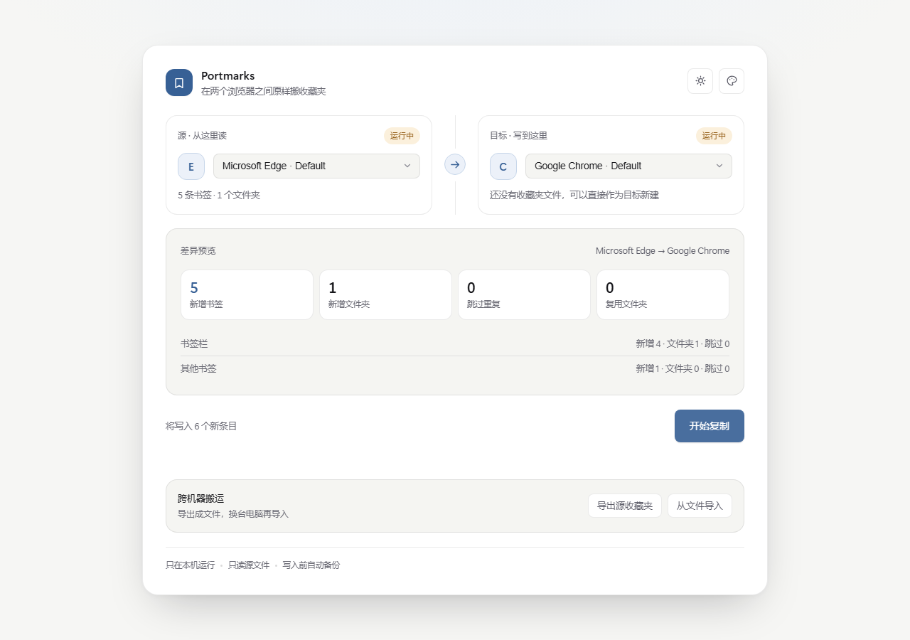
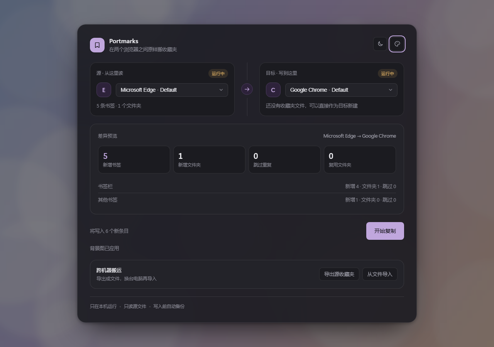

# Portmarks 使用说明

在本机的 Edge / Chrome 之间按**原树结构**复制收藏夹。不用装扩展，不用导出文件，选两个下拉框点一下就行。



## 启动

双击项目根目录的 **`start.cmd`**。

它会启动一个只监听 `127.0.0.1` 的本地服务，并用默认浏览器打开界面。**关掉那个黑色命令行窗口，程序就退出了**，不会常驻。

需要 Node.js 18+。

## 用一次

```
源     [ Microsoft Edge · 用户配置 1 · 27 条      ▾ ]
目标   [ Google Chrome · 个人 · 还没有收藏夹      ▾ ]
──────────────────────────────────────────
新增 27 条书签 / 7 个文件夹
跳过 0 条重复 · 复用 0 个已有文件夹
[ 开始复制 ]
```

1. 选源。目标下拉框里**只会出现另一个浏览器**——Edge 里选源，目标就只有 Chrome
2. 中间立刻显示差异：新增多少、跳过多少、复用几个文件夹
3. 点「开始复制」

## 外观

右上角的调色盘图标打开外观面板，设置都存在本机浏览器里，不上传任何地方。

- **7 套淡雅主题色**：雾蓝、鼠尾草、藕粉、杏桃、薰衣草、青瓷、沙金。每套色只用**一个色相**推导出强调色、深色描边、浅色底纹四档，深浅主题共用一套算法，不会出现某个颜色只有一半能用
- **三种显示模式**：跟随系统 / 浅色 / 深色。右上角的月亮图标可以一键切换
- **背景图**：可以上传任意图片，程序会先压到 1600px 以内再存（避免撑爆浏览器存储），三个滑块分别控制
  - **不透明度**：图片本身的可见度
  - **模糊**：柔化背景，让前景更清楚
  - **遮罩**：叠在图片上的那层底色浓度，调高文字更清楚



主面板是一块半透明玻璃卡片，背景图只在四周透出来，所以文字始终压在不透明表面上，不会被照片干扰。

## 跨机器搬运（导出 / 导入）

主界面底部有「跨机器搬运」一块，两个入口各自只依赖一侧：

| 操作 | 用哪一侧 | 说明 |
|---|---|---|
| **导出源收藏夹** | 只看**源** | 把当前源的收藏夹打包成 `.portmarks` 文件，换个系统或机器再导入。只读，不改任何数据 |
| **从文件导入** | 只看**目标** | 选好文件先算差异（新增多少、跳过多少、复用几个文件夹），确认后再点「写入目标」 |

导入同样要求目标浏览器先退出，同样会先备份原文件。文件格式见 `docs/spec.md`，是本工具自己的结构（JSON），能完整保留文件夹层级与顺序，不是浏览器那种只能全量追加的 HTML。

## 唯一一条硬性前提：目标浏览器必须完全退出

浏览器内存里有一份收藏夹，退出时会整体写回磁盘。它开着的时候改文件，改动会被覆盖，甚至可能损坏数据。

所以复制前请**完全退出目标浏览器**，包括右下角托盘里的后台进程（Edge 关掉窗口后仍可能驻留，在托盘图标上右键退出，或任务管理器结束 `msedge.exe`）。

源浏览器**开着没关系**，程序只读它的文件。

程序不会替你关闭浏览器，也不会偷偷动它——这是刻意的。

## 自动备份

真正写入前，程序会先把目标的 `Bookmarks` 文件原样复制一份，文件名形如：

```
Bookmarks.pmbak-20261126-201530
```

就放在原文件旁边。复制完界面会提示备份文件名。

**要手动恢复**：完全退出目标浏览器 → 把 `Bookmarks.pmbak-...` 改名为 `Bookmarks` 覆盖原文件 → 重新打开浏览器。

浏览器自己也会保留一份 `Bookmarks.bak`，那是它自己维护的，跟本工具无关。

## 安全边界

| | |
|---|---|
| 网络 | 只监听 `127.0.0.1`，不对外，不联网，无遥测 |
| 源数据 | 只读文件，绝不写入 |
| 目标数据 | 只新增节点，不修改、不删除你已有的任何书签 |
| 其他数据 | 完全不碰历史记录、Cookie、密码、扩展、设置 |
| 浏览器进程 | 不会替你启动或关闭任何浏览器 |

## 合并规则

| 情况 | 处理 |
|---|---|
| 目标有同名文件夹（同一层级） | **合并**进去，不新建副本 |
| 书签网址和标题都相同 | **跳过** |
| 网址相同、标题不同 | 视为两条书签，**新增** |
| 目标同名位置是书签而非文件夹 | 新建 `F (2)` |
| 目标没有 | 新建，**追加到末尾** |
| 源里的空文件夹 | 照建 |
| 顶层容器 | 收藏夹栏 → 收藏夹栏，其他收藏夹 → 其他收藏夹 |

按「网址 + 标题」判重，所以**反复复制是幂等的**：源里新增 5 条，再点一次就只多这 5 条。

## 目标浏览器还没收藏过东西

也能用。Chrome / Edge 在你还收藏过任何网页之前，配置目录里**根本没有 `Bookmarks` 文件**，下拉框里会显示「还没有收藏夹」。选中它照样能复制，程序会按 Chromium 的规范生成一份合法的文件，浏览器下次启动就会读进去。

## 已知限制

- **创建时间保不住**：新书签的时间会记成复制那一刻
- **只处理两个可写容器**：「收藏夹栏」和「其他收藏夹」。Edge 的「移动设备书签」「Workspaces」是只读的特殊容器，不读也不写
- **同一个浏览器内不能互传**：源选了 Edge，目标就只有 Chrome；想在 Edge 的两个配置之间搬，得先把目标配置换成另一个浏览器，或者直接拷 `Bookmarks` 文件
- **没有撤销功能**：写错了只能用上面说的备份手动恢复
- **账号同步**：如果目标浏览器登录了账号并开启同步，复制进去的书签会同步到你的账号和其他设备
- **只支持 Chromium 系**：Edge、Chrome。Firefox 用的是另一种存储格式
- **只在同一台机器上**：直接操作本机文件，没有云端，也没有跨机器功能

## 开发者

```bash
npm test        # 34 项测试：合并规则 + 文件读写 + 导出导入 + 页面结构
npm run check   # 读本机真实 Bookmarks 文件做校验（只读，不写入）
node tools/verify-in-browser.mjs "<user-data-dir>"   # 用真实浏览器验证它到底加载了哪些书签
node tools/shoot-ui.mjs http://127.0.0.1:7801 ./shots # 对运行中的界面批量截图，改样式后自查
```

参与开发前先读 **[CONTRIBUTING.md](../CONTRIBUTING.md)**：Git 分支与提交规范、编码约定、评审清单，以及这个项目踩过的四个坑。

`docs/spec.md` 里定义的 `.portmarks` 就是「导出 / 导入」用的格式。
